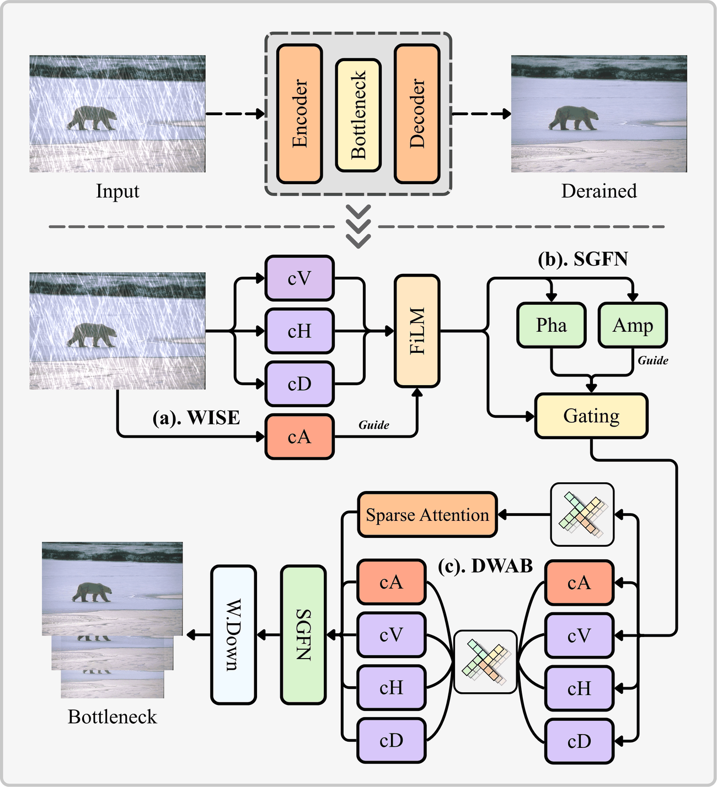
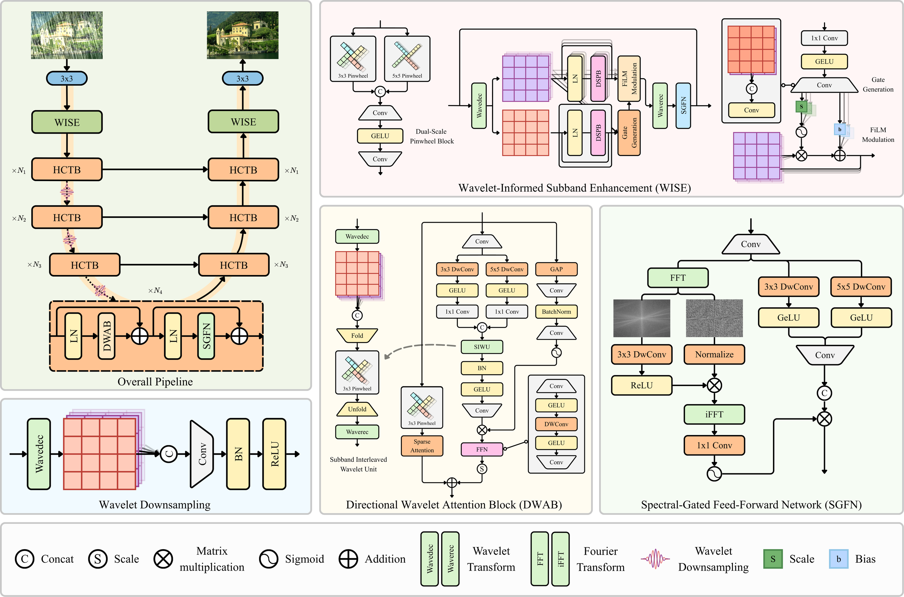
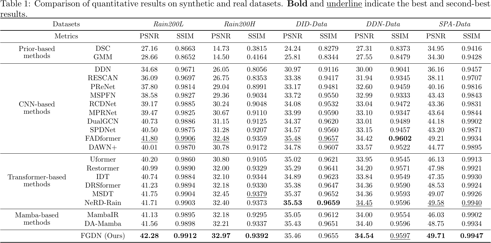
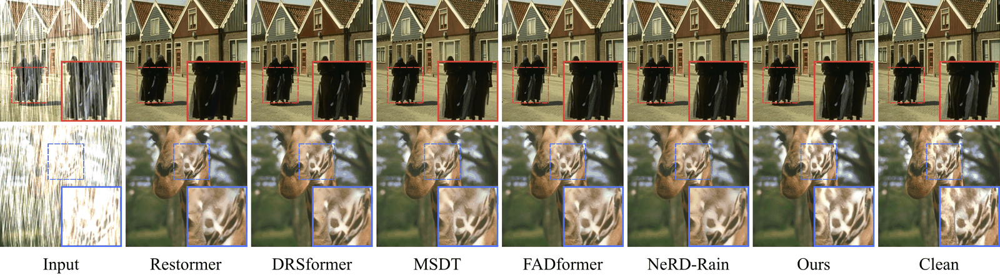
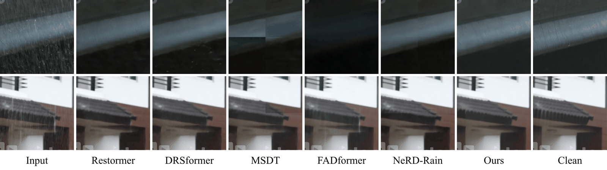

# FGDN: Bridging Wavelet and Fourier Domains for Direction-Aware Single-Image Deraining

Qi Zhang<sup>1</sup>, Zhe Zhu<sup>2</sup>, Xiaobin Li<sup>3</sup>, Lei Zhang<sup>4</sup>, Ming Meng<sup>5,*</sup>

<sup>1</sup>Hainan International College, Communication University of China &nbsp; <sup>2</sup>Samsung Research America &nbsp; <sup>3</sup>Hebei Normal University &nbsp; <sup>4</sup>Beijing Technology and Business University &nbsp; <sup>5</sup>Communication University of China

<sub>* Corresponding author</sub>

[](https://github.com/zq2000/FGDN) 
[](LICENSE)

*A unified encoder–decoder network bridging wavelet and Fourier domains for direction-aware single-image deraining.*

<table>
  <tr>
    <td width="52%" align="center" valign="middle">
      
    </td>
    <td width="48%" valign="middle">
      The overall encoder-bottleneck-decoder pipeline takes a rainy image and produces a derained output. <b>WISE</b>, <b>DWAB</b>, and the wavelet-based downsampling handle subband enhancement, joint spatial-frequency extraction, and frequency-preserving scale transitions across the encoder-decoder pipeline.
    </td>
  </tr>
</table>

<hr />

> **Abstract:** *Single-image deraining remains challenging because rain streaks are anisotropic, spatially entangled with scene content, and distributed across multiple scales. Inspired by recent advances in directional rain modeling and frequency-domain analysis, we argue that jointly modeling directional structure, localized frequency patterns, and global spectral statistics is essential but remains underexplored. In this paper, we propose the Frequency-Guided Directional Deraining Network (FGDN), a unified encoder-decoder framework that bridges wavelet and Fourier domains for direction-aware image deraining. Since wavelet decomposition separates scene structure from directional rain information, we design the Wavelet-Informed Subband Enhancement (WISE) module. Enhanced low-frequency features adaptively modulate high-frequency subbands through affine gating. Building on this, the Directional Wavelet Attention Block (DWAB) fuses direction-aware sparse attention with subband-interleaved wavelet convolution to jointly capture global dependencies and local directional patterns. To complement wavelet modeling with global spectral discrimination, the Spectral-Gated Feed-Forward Network (SGFN) introduces a Fourier amplitude gate that selectively modulates spatial features through cross-domain gating. Throughout the network, Pinwheel Convolution serves as the direction-aware building block for encoding anisotropic rain structures. Extensive experiments on five deraining benchmarks show that FGDN achieves state-of-the-art or highly competitive performance with favorable model complexity. Our code is publicly available.* 
<hr />

## 🗂️ Repository Structure

```
FGDN/
├── basicsr/                 # BasicSR-style training platform (DRSformer-derived)
│   └── archs/FGDN_arch.py   # FGDN network (WISE / DSPB / DWAB / SGFFN / PConv)
├── options/                 # training configs of the five benchmarks
├── evaluations/             # PSNR/SSIM, cross-dataset, FLOPs, and IQA scripts
├── datasets/                # dataset skeleton and download instructions
├── test.py                  # standalone inference (no BasicSR install needed)
├── train.sh                 # single-GPU training entry
├── requirements.txt / setup.py
└── assets/
```

## 🏗️ Network Architecture



FGDN follows a four-level U-shaped encoder-decoder structure. WISE modules are deployed at both the encoder front-end and decoder refinement stage. Each level consists of stacked Hybrid CNN-Transformer Blocks (HCTBs), each comprising a DWAB and an SGFN. Wavelet-based downsampling and PixelShuffle upsampling are used for multi-scale transitions.

## 📊 Results

Experiments are performed on five benchmarks: Rain200L, Rain200H, DID-Data, DDN-Data (synthetic), and SPA-Data (real-world). **Bold** and <u>underline</u> indicate the best and second-best results.

<details>
<summary><strong>Quantitative Comparison on Synthetic and Real Datasets</strong> (click to expand)</summary>



</details>

<details>
<summary><strong>Visual Comparison on Synthetic Datasets</strong> (click to expand)</summary>



</details>

<details>
<summary><strong>Visual Comparison on Real-World Data (SPA-Data)</strong> (click to expand)</summary>



</details>

## ⚙️ Installation

```bash
git clone https://github.com/zq2000/FGDN.git
cd FGDN
pip install -r requirements.txt

# optional dependencies
pip install fvcore   # FLOPs / parameter counting (evaluations/calc_params_flops.py)
pip install pyiqa    # no-reference IQA metrics (evaluations/standard_iqa_compare.py)
```

## 📁 Datasets

The five benchmarks used in the paper. Download instructions and the expected folder layout are given in [datasets/README.md](datasets/README.md).

| Dataset | Type | Introduced by |
|---------|------|---------------|
| Rain200L | Synthetic | JORDER (Yang et al., CVPR 2017) |
| Rain200H | Synthetic | JORDER (Yang et al., CVPR 2017) |
| DID-Data | Synthetic | DID-MDN (Zhang et al., CVPRW 2018) |
| DDN-Data | Synthetic | DDN (Fu et al., CVPR 2017) |
| SPA-Data | Real-world | Model-driven DNN (Wang et al., CVPR 2019) |

## 🚀 Training

```bash
python setup.py develop --no_cuda_ext   # one-time (or: export PYTHONPATH=$(pwd))
CUDA_VISIBLE_DEVICES=0 python basicsr/train.py -opt options/Rain200H.yml
```

or simply:

```bash
./train.sh
```

Training follows the paper protocol (Sec. 4.1.3): AdamW, batch 8, 128×128 patches, 300k iterations, cosine-annealing restart schedule, L1 loss, and random geometric augmentation. The configs of the other benchmarks are in `options/`.

## 🧪 Testing

Standalone inference with a pre-trained checkpoint (no BasicSR installation required):

```bash
# 1. download a checkpoint (see below) into ./pretrained/
# 2. edit the block at the top of test.py:
#      INPUT_DIR / RESULT_DIR / WEIGHTS / YAML_PATH
python test.py
```

## 📦 Pre-trained Weights

Checkpoints of FGDN on all five benchmarks. Metrics: PSNR (dB) / SSIM on the Y channel.

| Dataset | PSNR / SSIM | Checkpoint | Download |
|---------|-------------|------------|----------|
| Rain200L | 42.28 / 0.9912 | `Rain200L.pth` | [Baidu Netdisk](https://pan.baidu.com/s/1ngBL1p0Y7Jf9-drY__gEKA?pwd=pjk2) |
| Rain200H | 32.97 / 0.9392 | `Rain200H.pth` | [Baidu Netdisk](https://pan.baidu.com/s/1vbkM6U1j-p7miOQUv-HYbw?pwd=swej) |
| DID-Data | 35.46 / 0.9655 | `DID-Data.pth` | [Baidu Netdisk](https://pan.baidu.com/s/12t3CcREDIBoTw_7MR8_mDg?pwd=2e3w) |
| DDN-Data | 34.54 / 0.9597 | `DDN-Data.pth` | [Baidu Netdisk](https://pan.baidu.com/s/18Nm6qY89085FeXPtr4a0Mw?pwd=dv1h) |
| SPA-Data | 49.71 / 0.9947 | `SPA-Data.pth` | [Baidu Netdisk](https://pan.baidu.com/s/1Cj7xV2EWOEjSakTAZSqyFg?pwd=xdps) |

Each checkpoint is shared as an individual file.

## 📦 Reproduced DAWN+ Checkpoints

The DAWN+ comparison in the paper (Sec. 4.2.1) uses a reproduction with the
official implementation, retrained on each benchmark with a budget-proportional
learning-rate schedule. These checkpoints are also released:

| Dataset | PSNR / SSIM | Checkpoint | Download |
|---------|-------------|------------|----------|
| Rain200L | 40.01 / 0.9870 | `DAWNplus_Rain200L.pth` | [Baidu Netdisk](https://pan.baidu.com/s/1W7XjFROVvD578rjaf5B13g?pwd=qwt3) |
| Rain200H | 30.78 / 0.9172 | `DAWNplus_Rain200H.pth` | [Baidu Netdisk](https://pan.baidu.com/s/1mA8Qexk1TqbTJUL0hts3gg?pwd=ydt6) |
| DID-Data | 34.78 / 0.9607 | `DAWNplus_DID-Data.pth` | [Baidu Netdisk](https://pan.baidu.com/s/1jqTlYJ0MpM2seyBZSz-24g?pwd=g7ds) |
| DDN-Data | 33.57 / 0.9522 | `DAWNplus_DDN-Data.pth` | [Baidu Netdisk](https://pan.baidu.com/s/1viNf6BziJioBCdMpyNu6Bw?pwd=5whm) |
| SPA-Data | 44.77 / 0.9895 | `DAWNplus_SPA-Data.pth` | [Baidu Netdisk](https://pan.baidu.com/s/1mW9GKcz4IeVO4FRZKdwNwQ?pwd=bw6w) |

## 🖼️ Visual Results

The derained outputs of FGDN on all five benchmarks can be downloaded here (code: `1234`):

| Dataset | Link |
|---------|------|
| Rain200L | [Baidu Netdisk](https://pan.baidu.com/s/1ZXNLDLcXNdm3KLG6ECxfCg?pwd=1234) |
| Rain200H | [Baidu Netdisk](https://pan.baidu.com/s/1QRHvTKWTtAZzBWuyu0csGg?pwd=1234) |
| DID-Data | [Baidu Netdisk](https://pan.baidu.com/s/1PZkIui_zo5Y6-rUCz-OfAQ?pwd=1234) |
| DDN-Data | [Baidu Netdisk](https://pan.baidu.com/s/16cvI37jGBMSy46kuLe27QQ?pwd=1234) |
| SPA-Data | [Baidu Netdisk](https://pan.baidu.com/s/17btomBXH_xvLPfDEngCirA?pwd=1234) |

## 📖 Citation

The paper is currently under review. If you find this code useful, you may cite the repository for now:

```bibtex
@misc{fgdn2026repo,
  title        = {FGDN: Bridging Wavelet and Fourier Domains
                  for Direction-Aware Single-Image Deraining},
  author       = {Zhang, Qi and Zhu, Zhe and Li, Xiaobin and Zhang, Lei and Meng, Ming},
  year         = {2026},
  howpublished = {\url{https://github.com/zq2000/FGDN}},
  note         = {Code repository; paper under review}
}
```

The BibTeX entry of the paper will be added upon acceptance.

## 🙏 Acknowledgment

This code is based on the [DRSformer](https://github.com/cschenxiang/DRSformer) restoration framework and the [BasicSR](https://github.com/XPixelGroup/BasicSR) toolbox. We thank the authors for releasing their code.

## ⚖️ License

This project is released under the [Apache-2.0](LICENSE) license.
